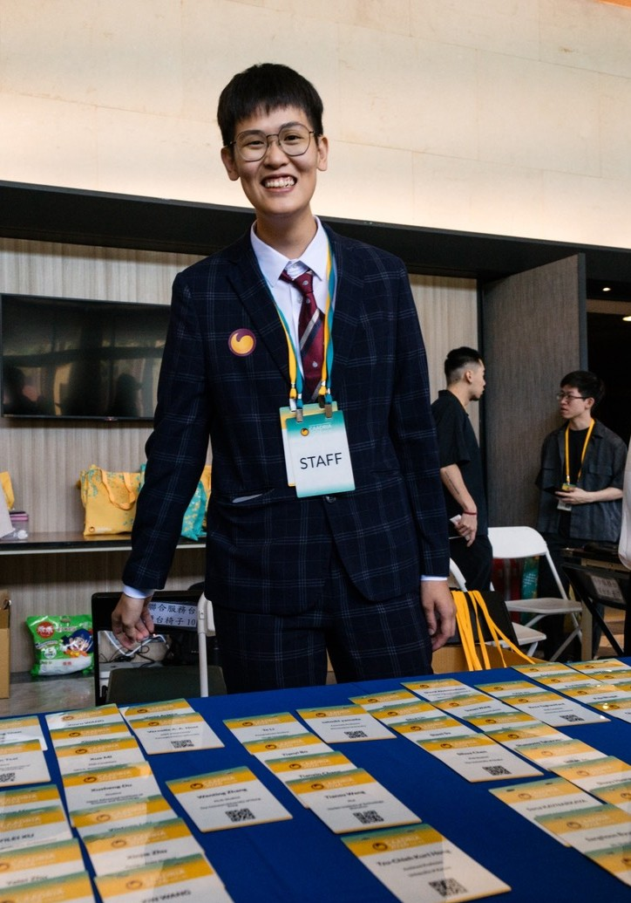

YISHENG EZRA WU

**Multimodal AI & HCI Researcher / Systems Engineer**

專注於 多模態人工智慧（**Multimodal AI**）、生理訊號與自然語言融合技術，以及 端到端軟硬整合產品落地。

融合「資訊管理系統架構」與「數位媒體互動設計」雙重視野，致力於將前瞻人機互動研究轉化為具商業與社會價值的系統解決方案。

###  核心旗艦成果 (Flagship Projects)

01\. 生理與語意多模態協作評估系統

 學術發表：_IEEE MIPR 2026 (International Conference on Multimedia Information Processing and Retrieval)_

[Click me](https://ieeexplore.ieee.org/document/11716248)

 論文題目：_Beyond Semantic Distance: Fusing Physiological and Linguistic Signals for Multimodal Coordination Assessment in Cross-Disciplinary Design_

 核心技術：多模態特徵融合（Multimodal Feature Fusion）、生理訊號處理（Physiological Sensing）、自然語言處理（NLP）

 專案概述：突破傳統僅依賴語意分析的限制，首創融合生理感測與語言特徵的評估模型，實現跨領域團隊協作與複雜人機互動過程中的客觀、即時協同效益量測。

02 視障兒童智慧多模態學習輔具平台

 專案週期：[2024/09 – 2025](tel:2024/09%20-%202025)/04

 核心架構：RAG (Retrieval-Augmented Generation) ✕ 雲端微服務 (Azure) ✕ 自研 IoT 互動硬體

 解決痛點：針對視障兒童早期認知教育的痛點，自研實體硬體感應模組並結合生成式 AI 檢索技術，打造低延遲、高適應性的多模態語音互動學習載體。

 交付成果：完整主導從使用者經驗研究（User Research）、軟硬體系統架構、演算法整合至實體場域測試的全生命週期（End-to-End）產品落地。

### 研發與領導經歷 (Experience & Leadership)

雲科大 互動運算研究室 **(Interactive Computing Lab)** ｜ 獎助研究生 _(2026/01 –_ 至今\*)\*

- 主導多模態生理與行為訊號運算研究，推進前沿人機互動技術與系統雛型驗證。

 **CAADRIA 2026** 國際工作營 ｜ Workshop Assistant _(2026)_

- 支援國際計算輔助建築與互動設計工作營之演算法與技術落地協調。

Google｜Google Developer Student Community in YUNTECH 技術推廣 (2024-2025)

- 推廣前沿雲端架構與 AI 開發者工具，主辦並推動技術社群專案。

 **OPENHCI** 人機互動工作坊 ｜ 技術助教 (Technical Teaching Assistant) _(2024)_

- 指導跨領域團隊進行硬體感測原型打造與軟硬整合除錯。

 創科資訊 **(Trunk Studio)** ｜ 軟體研發實習生 *(*[_2023/01 – 2023_](tel:2023/01%20-%202023)*/07)*

- 參與商用軟體功能開發與系統架構維護，落實現代化敏捷開發流程。

### 精選商業與技術榮譽 (Selected Honors)

 商業創新與價值創造

1.  雲林國際創新創業營隊｜冠軍 _(2024)_
2.  技職盃黑客馬拉松｜最佳創造價值獎 _(2024)_
3.  雲林國際創新創業營隊｜季軍 _(2025)_

 演算法與前沿互動

1.  OPENHCI 人機互動工作坊｜最佳故事獎 **(Best Storytelling)** _(2024)_
2.  海峽兩岸青少年人工智慧大賽｜三等獎 _(2024)_

🌐 語言能力與個人特質 (Languages & Beyond)

 多語溝通：中文 (Native)、English (Fluent/Professional)、Deutsch (Intermediate)、Español (Basic/Learning)

 生活與探索：PADI 進階開放水域潛水員 (AOW)、野溪溫泉探勘、森林徒步、Espresso 萃取研發。專注於在理性系統架構與感性自然體驗之間取得極致平衡。
